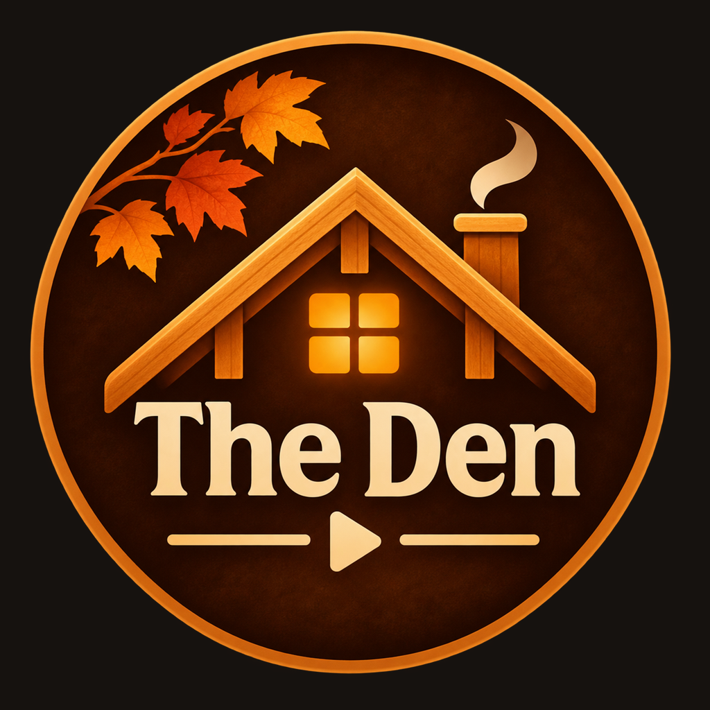
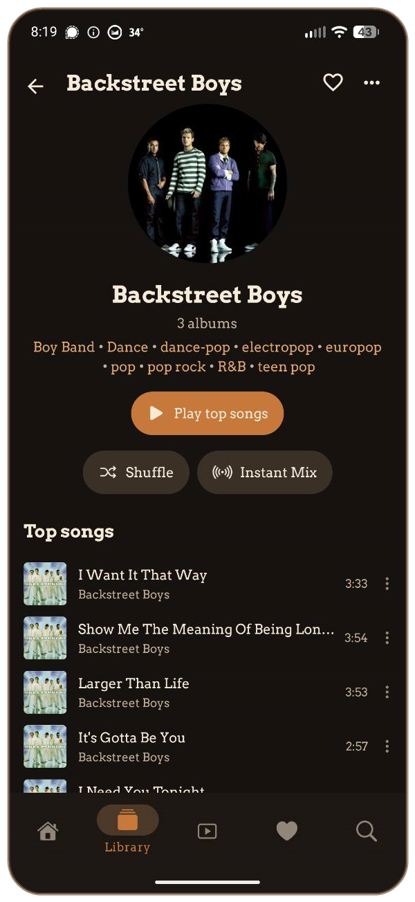
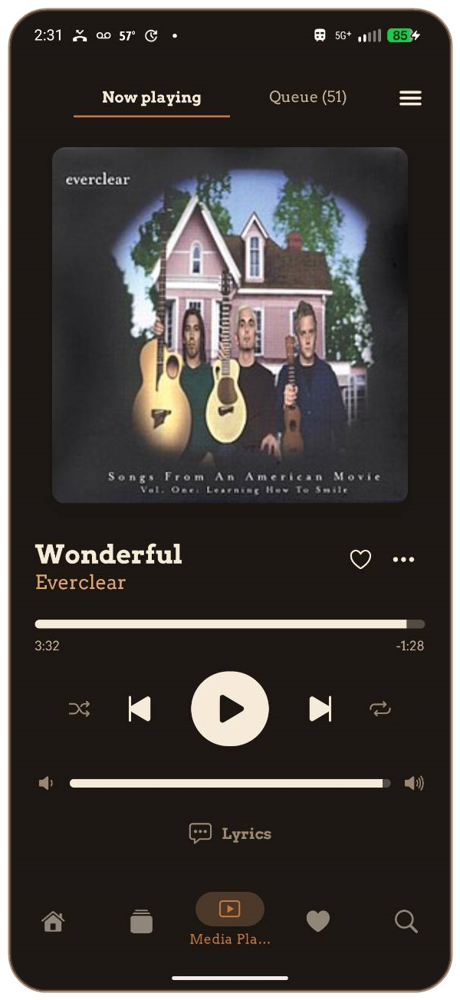
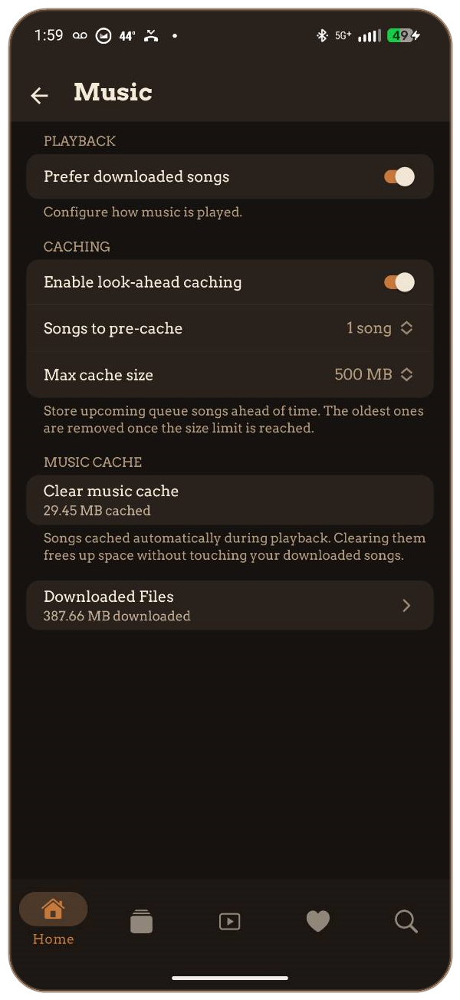

# The Den

  

<strong>A warm place for the stories and music we share.</strong>

The Den is an Android app for watching movies and shows and listening to music with family and friends. It connects to **Graze**, our private media service. The app is free to use for invited members. There are no rentals, purchases, or paid access tiers, and the app does not include a public media catalog.

## Take a look

These screens show the **Golden Hour** theme in development builds. Small details may change between releases. The Den also includes a classic theme and supports custom theme files.

  
  &nbsp;&nbsp;
  
  &nbsp;&nbsp;
  

## What you can do

- **Find something to enjoy.** Browse movies, shows, albums, artists, playlists, and music genres. Pick up where you left off or explore featured recommendations chosen for the season.
- **Watch your way.** Resume a movie or episode, manage playback controls and skip prompts, or keep video playing in a small player while browsing inside The Den. Android picture-in-picture is also available when leaving the app.
- **Make music yours.** Build and reorder a queue, play or shuffle an album, discover songs with Instant Mix, and save music for offline listening. Lyrics can follow the song when a synced version is available.
- **Keep what matters close.** Favorite movies, shows, artists, albums, playlists, and songs; manage downloaded files; and choose the look that feels like home.
- **Share better lyrics.** Read lyric history, choose a preferred version, and submit a plain-text version for a song when your Graze account has permission.

Features depend on the media available to your Graze account and the version of the app you have installed.

## Install on Android

1. Open this repository's **Releases** page and download the latest **The Den APK** for your device.
2. To receive future updates through [Obtainium](https://github.com/ImranR98/Obtainium), add this repository's URL there and select the The Den APK. If a release is marked as a prerelease, enable prerelease updates for this app.
3. Open The Den and sign in with the Graze account provided to you.

An invitation to Graze is required to browse or play media. This repository is the download and update channel for the Android app; the owner posts releases and update notes here.

## Why The Den exists

The Den is meant to feel like a shared living room: familiar, easy to use, and welcoming across generations. The goal is to give a small circle of family and friends a thoughtful way to enjoy the media already available to them through Graze. We are building around useful playback, clear organization, accessibility, and a personal touch rather than a storefront.

## On the roadmap

These are directions for future work, not features promised in the current APK:

- More control over which media each family member can discover.
- A dedicated podcast home for following shows and episodes, with audio, video, and supported live broadcasts.
- Better cross-device continuity for follows and listening progress.
- More themes and refinements to the Golden Hour experience.
- More Installation Options
- • SmartTV (Roku, Android TV, Dedicated Hardware)
- • iPhone and iOS devices
- • PC/Laptop Experience (via web portal or dedicated Windows/MacOS apps)

## Credits

The Den builds on work from many open-source creators and communities. You can also find these credits in the app's Settings.

| Creator or community | Contribution and support |
| --- | --- |
| Fredrik Burmester and contributors | [Original mobile-client project](https://github.com/streamyfin/streamyfin) · [Project contributors](https://github.com/streamyfin/streamyfin/graphs/contributors) |
| Felitendo and contributors | [Lyrics project](https://github.com/Felitendo/jellyfin-plugin-lyrics) · [Project contributors](https://github.com/Felitendo/jellyfin-plugin-lyrics/graphs/contributors) |
| mpv contributors | [Video player](https://mpv.io/) · [Contribute](https://github.com/mpv-player/mpv/blob/master/DOCS/contribute.md) |
| Double Symmetry and lovegaoshi | [React Native Track Player](https://github.com/doublesymmetry/react-native-track-player/tree/v4) · [Player fork](https://github.com/lovegaoshi/react-native-track-player) · [Contribute](https://github.com/doublesymmetry/react-native-track-player) |
| LRCLIB contributors | [Lyrics library](https://lrclib.net/) · [Support](https://github.com/sponsors/tranxuanthang) |
| Anton Koovit | [Arvo typeface](https://antonkoovit.com/typefaces/arvo) · [Designer](https://antonkoovit.com/) |
| Abbie Gonzalez | [OpenDyslexic typeface](https://opendyslexic.org/) · [Support](https://antijingoist.itch.io/opendyslexic) |
| Noto Project contributors | [Noto fonts](https://github.com/notofonts) · [Contribute](https://github.com/notofonts/noto-docs/blob/main/docs/website/contribute.md) |

The Den does not provide movies, shows, or music with its download. Media access is determined by each member's Graze account.
